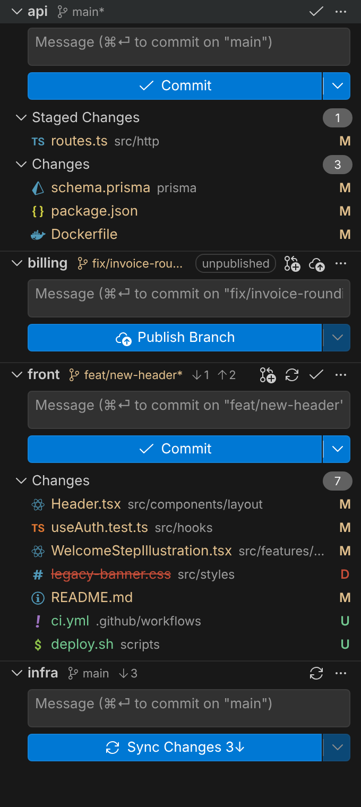

# Workspace Changes

A **Workspace Changes** panel for the Source Control sidebar of VS Code / Cursor. Built for workspaces with many repos: each repo is laid out like the native view (header, commit message box, Commit button, Staged Changes / Changes), but only the repos you care about are shown.

## Looks native

- **File icons come from your active file icon theme** (Seti, Material Icon Theme, vscode-icons, …), resolved the same way VS Code does it: this is a port of VS Code's own icon-theme loader (`fileIconThemeData.ts`) and file-to-class logic (`getIconClasses.ts`), including font-based and SVG themes, light/high-contrast variants, `files.associations` and language detection. Switching icon theme updates the panel immediately.
- **All other icons are the official codicons**, the exact SVGs VS Code ships.
- Colors, fonts and buttons use your color theme's variables.

## Behaves native

Every repo action runs the Git extension's own command for that repo, the same code path as the native buttons:

| Action | Native command |
|---|---|
| Commit (button, ⌘⏎ / Ctrl+Enter) | `git.commit`, with the message placed in that repo's input box |
| Commit (Amend), Commit & Push, Commit & Sync | `git.commitAmend`, `git.commit` with post-commit `git.push` / `git.sync` |
| Publish Branch, Sync Changes, Pull, Push | `git.publish`, `git.sync`, `git.pull`, `git.push` |
| Branch name click / checkout default | `git.checkout` (branch picker / target branch) |
| Stage All, Unstage All, Stash, Pop Stash | `git.stageAll`, `git.unstageAll`, `git.stash`, `git.stashPopLatest` |

So commit hooks (pre-commit, commit-msg, husky, lint-staged…) run, failures show the native error with **Show Command Output**, the message stays in the box for a retry, unsaved files are saved first (`git.promptToSaveFilesBeforeCommit`), and smart commit, branch protection, GPG signing, sign-off and `git.postCommitCommand` behave exactly as in the native view. The message box is shared with the native view's box for that repo.

## Each repo block

- **Header**: repo name, branch (highlighted when not the default branch, `*` when dirty, **click to switch branch**), the sync status like the native status bar, `⟳ 4↓ 0↑` (**click `↓` to pull, `↑` to push, `⟳` to sync**), *unpublished* tag, then actions: **Create Pull Request**, Publish, Commit, and **`…`**.
- **`…` menu** (also on right-click of the repo header): VS Code's own native menu, with the same entries as the Source Control view's `…`: Pull, Push, Clone, Checkout to..., Fetch, then **Commit ▸**, **Changes ▸**, **Pull, Push ▸**, **Branch ▸**, **Stash ▸** (every entry and `when` condition copied from the Git extension, e.g. *No Verify* items only with `git.allowNoVerifyCommit`), then Create Pull Request, Checkout default branch, Open Terminal, Reveal in Explorer, Always Hide, Show Git Output. Each entry runs the native command for *that* repo (no repository picker).
- **Create Pull Request** (shown on non-default branches): uses the *GitHub Pull Requests* extension's create view when it's installed and the remote is on GitHub; otherwise opens the host's create page in the browser (GitHub, GitHub Enterprise, GitLab, Bitbucket, Azure DevOps), offering to publish the branch first if needed.
- **Primary button**: *Commit* when there are changes, else *Publish Branch* or *Sync Changes*. The dropdown is a native menu with the same entries as the native button: Commit, Commit (Amend), Commit & Push, Commit & Sync.
- **Merge / Staged / Changes groups** with counts. Hover a row for open file, discard, stage / unstage; click a file to open its diff. Right-click repos, groups and files for the same actions.
- Click a repo header to collapse it. Clean repos with nothing to do start collapsed.

## Go to File in shown repositories

**`Cmd+Alt+P`** (`Ctrl+Alt+P` on Windows/Linux), or the panel's `…` menu: a Cmd+P-style file picker that only searches the repositories currently shown in the panel.

- Same ranking as Cmd+P: a port of VS Code's own Quick Open scorer, checked against VS Code's own test suite. Prefix and camel-case matches, path queries (`comp/head`), several words (`use auth`), `"quotes"` for exact matches.
- Your file icon theme's icons, recently opened files first, `file.ts:12:4` to jump to a line, the split button to open to the side.
- Lists what Cmd+P would: tracked and untracked files, minus `.gitignore`d files, `files.exclude` and `search.exclude`.
- Change the shortcut in Keyboard Shortcuts (search *Go to File in Shown Repositories*); bind it to `Cmd+P` to replace the normal picker.

## Filters (all live)

| Button | What it does |
|---|---|
| **Filter** (funnel) | Which rules make a repo appear. A repo is shown if it matches **any** checked rule: *Has changes*, *Not on default branch*, *Has unpushed commits*, *Behind upstream*. Uncheck all to show every repo. Default: changes + not on default branch. |
| **Search** | Filter by repo name, path or branch as you type. Space/comma separated (any matches), `!term` excludes. Enter keeps it, Esc reverts. |
| **Eye** | Temporarily show all repos. Click again to re-apply filters. |
| **Refresh** | Re-reads default branches and the icon theme. |
| **Collapse All / Expand All** | One toggle button, like the native views: shows Collapse All while any repo is open, Expand All once all are collapsed. |
| `…` → **Manage Always-Hidden Repositories** | Un-hide repos hidden with *Always Hide Repository*. |

## Settings

| Setting | Default | |
|---|---|---|
| `workspaceChanges.criteria` | `["changes", "nonDefaultBranch"]` | Rules; also set by the filter button |
| `workspaceChanges.defaultBranchNames` | `["main", "master"]` | Used when a repo has no `origin/HEAD` |
| `workspaceChanges.hiddenRepositories` | `[]` | Never show these. Folder name or relative path, `*` / `?` wildcards |
| `workspaceChanges.createPullRequest` | `"auto"` | `auto` (GitHub PR extension if installed, else browser) or `browser` |

The default branch comes from `refs/remotes/origin/HEAD`. If a repo lacks it (old clones), the branch tooltip says *guessed*; fix with `git remote set-head origin -a`.

## Install

- **VS Code**: search *Workspace Changes* in the Extensions view (VS Code Marketplace).
- **Cursor, VSCodium, Windsurf…**: search *Workspace Changes* in the Extensions view (Open VSX).
- **From a file**: download the `.vsix` from [Releases](https://github.com/garrisonblair/workspace-changes/releases), then Extensions view → `…` → **Install from VSIX…**

Requires the built-in Git extension (enabled by default).

## Development

Plain JavaScript, no build step. `src/` runs in the extension host, `media/` is the panel UI.

- `node scripts/gen-manifest.js` regenerates the repo menu in `package.json` from `src/gitMenu.js`.
- `node test/run.js`: unit tests (filters, icon theme port against the real Seti theme and VS Code's built-in language definitions, PR URLs) and an end-to-end run against a mocked VS Code API and Git extension commands over real git repos, including commit hooks.
- `python3 test/webview_test.py`: drives the panel in headless Chromium with VS Code Dark Modern colors, the Seti font theme and an SVG theme; saves screenshots to `images/` (needs Playwright).
- `python3 scripts/build-codicons.py <vscode-codicons checkout>` regenerates `media/codicons.js`.
- Open this folder in VS Code and press F5 to try it live.
- Releasing: see [PUBLISHING.md](PUBLISHING.md).

Codicons © Microsoft, licensed CC BY 4.0 (`media/CODICONS-LICENSE`).
